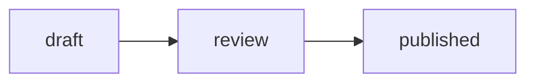

# Markdown

`.md`, `.markdown` and `.mdx` files open with four view tabs: **Editor**, **Interactive**, **Split** and **Preview**.  
The toolbar also carries a `Markdown` badge and the **Copy raw**, **Copy formatted**, **Compare with…**,
**Convert to HTML**, **Export HTML**, **Export PDF** and **Save** buttons.

## Views

- **Editor:** the source, with Markdown highlighting.
- **Interactive:** the document drawn with its formatting while you edit it, like a rich-text editor;
  the file stays Markdown.
  Its tooltip reads **Edit with the formatting shown; the file stays Markdown**.
  See [Interactive view](#interactive-view).
- **Split:** the source on the left under **Source**, the rendered document on the right under **Preview**.
  The preview updates on every keystroke.
  Drag the divider to change the ratio, from 10% to 90%.
  The ratio lasts while you edit; switching views or tabs puts the panes back at half and half.
  At 720 px wide or less, the preview sits under the source and there is no divider.
- **Preview:** the rendered document alone, scrollable.

A Markdown file opens in **Preview**; a new one made with **New file** opens in **Editor**.  
The view you pick stays while you switch between open tabs.  
**Compare with…** opens a document-style diff in a new diff tab; see [Compare](Compare.md#markdown).  
`Ctrl+S` and the **Save** button save from all four views.  
**Editor**, **Interactive** and **Split** share one editor session per file,
so switching between them keeps the text, the caret, the selection and the undo history.

## Formatting

The [editor bar](Editor.md#editor-bar) above **Editor**, **Interactive** and **Split** carries,
after **Undo** and **Redo**, 11 formatting buttons in two groups split by a divider:
five inline formats, then six block formats.  
In **Split** the bar sits above both panes and formats the source.  
There is no bar in **Preview**.  
Hovering a button shows its name and shortcut, such as **Bold (Ctrl+B)**.  
Clicking a button keeps the focus, the caret and the selection in the text.

Inline formats wrap the selected text:

- **Bold** (`Ctrl+B`): `**text**`.
- **Italic** (`Ctrl+I`): `*text*`.
- **Strikethrough** (`Ctrl+Shift+X`): `~~text~~`.
- **Inline code** (`Ctrl+E`): `` `text` ``.
- **Link** (`Ctrl+K`): `[text](url)` with `url` selected, ready to type over.
  A selected web address, one that starts with a scheme and `://`, with `mailto:` or with `www.`,
  becomes `[address](address)` with the link text selected.
  In **Interactive**, **Link** opens a popover for the address instead; see [Links](#links).

With nothing selected, an inline format goes to the word at the caret, and the caret stays where it was in the word.  
With no word at the caret, it inserts its empty markers with the caret between them,
or removes the markers around the caret.  
**Link** links the word at the caret as `[word](url)` with `url` selected, or inserts `[](url)` when there is no word.

Block formats work on every selected line;
headings, quotes and lists skip blank lines unless nothing else is selected:

- **Heading level:** opens a menu of **Normal text** and **Heading 1** to **Heading 6**, with the current level checked.
- **Quote:** `> ` at the start of the line.
- **Code block:** opens a menu of languages:
  **No language**, then `bash` to `yaml` in alphabetical order, `mermaid` included,
  and **Remove code block** when the selection is in a code block.
  A choice wraps the lines in ```` ``` ```` fences with that language, or relabels the block around them.
- **Bulleted list:** `- `.
- **Numbered list:** `1. `, `2. `, and so on.
- **Task list:** `- [ ] `.

List markers go after the line's indentation, and a list button replaces another list marker on the same line.  
Every button without a menu toggles: applied to text that already has the format, it removes it.  
Inside a format, such as anywhere in `**bold words**` or in the text of a link, the button removes that format, markers and all.  
A button shows as pressed while the selection has its format, and follows the caret as it moves:
**Bold** anywhere inside `**…**`, **Heading level** while the first selected line is a heading,
and **Code block** while the selection is in a code block.  
The two menus drop down from the bar under their button.
They close on `Esc`, on a click outside, or on a second click of their button.  
Every action is one undo step, and the selection stays on the text.

### List keys

In **Editor**, **Interactive** and **Split**'s source:

- `Enter` continues a bulleted, numbered or task list, or a quote, on the next line.
  On an empty item it ends the list.
- `Backspace` at the start of an item's text removes its marker.
- `Tab` nests the selected items under the item above, lined up with its text,
  and `Shift+Tab` moves them back out to the parent's level; their sub-items move with them.
  On other lines `Tab` and `Shift+Tab` indent and outdent as usual.

## Interactive view

**Interactive** edits the document like a word processor, such as Word or Google Docs, with Markdown as the stored text.  
The Markdown syntax is never shown, wherever the caret or the selection is:
each construct shows its text formatted, and code blocks, diagrams and tables are edited in place.  
The text stays the file's Markdown, byte for byte, until you edit it.

- **Bold, italic, strikethrough and inline code:** the text is styled;
  `**`, `__`, `*`, `_`, `~~` and the backticks of inline code are hidden.
- **Links:** the link text shows as a link, with its address on hover;
  `[`, `](address "title")` and the labels of reference links are hidden.
  Clicking a link places the caret; it never opens the address.
  A reference definition such as `[docs]: https://example.com` shows as `docs → https://example.com`, with its title on hover.
- **Images:** a `data:` image shows in place,
  and so does a workspace image, by a relative or `/`-rooted path, as in the [preview](#images).
  A web image shows a placeholder with `Remote image not loaded (offline):` and its address, and is never fetched;
  a missing image shows `Image not found:` and its path.
  Clicking an image selects it, so `Delete` removes it.
- **Headings:** the `#` marks and the `===` or `---` underline are hidden, and the line takes the heading's size.
  A lone `#` stays text until a space follows it, so `#tag` types as text.
- **Quotes:** `>` is hidden and the lines get a border on the left.
- **Lists:** bullets show as `•`, numbered items as their number, counted as in the preview, and nested items step in.
  A marker stays text until a space follows it.
- **Task lists:** `- [ ]` and `- [x]` show as a checkbox, and a done task's text is struck through.
  Clicking a checkbox ticks or clears the task in the text, as one undo step.
- **Horizontal rules:** a line.
- **Escapes:** `\*` shows as `*`.
- **Raw HTML** stays as text, to edit as it is; the preview renders it.

The view hides the line numbers and the gutter, and sets the text in the interface font, up to 820 px wide.  
The editor bar, the formatting shortcuts, the [list keys](#list-keys), search with `Ctrl+F`, undo and redo work as in **Editor**.  
The bar's buttons show as pressed while the caret is in their format, such as **Bold** anywhere in bold text.  
A file over 500,000 characters opens in **Interactive** as plain source, with a note above it, so typing stays fast.

### Typing and the caret

- Hidden syntax is one unit: the arrow keys, `Home`, `End` and clicks never put the caret inside it,
  and each arrow press moves one visible character.
- The caret takes the formatting of the character before it.
  Typing right after bold text continues the bold,
  and typing right before bold text that follows plain text stays plain.
  At the end of a link the caret is after the link, so typing there is plain text.
- `Backspace` and `Delete` remove the visible character next to the caret, never a hidden marker;
  `Ctrl+Backspace` and `Ctrl+Delete` remove a word.
- When the last character of a formatted run goes, its markers go with it.
- In Markdown, bold, italic or struck text can't start or end with a space,
  so a space typed or left at the edge of such a run goes outside its markers;
  text typed on right after that space stays in the run, so `bold words` typed in bold stays bold.
  **Bold**, **Italic**, **Strikethrough** and **Inline code** with nothing selected and no word at the caret
  add an empty pair of markers for the next character typed;
  the pair goes away, without an undo step, when the caret moves on.
- Typing over selected text within one formatted run keeps its formatting.
  A selection across runs keeps the markers of the runs it cuts, and the typed text goes where the selection started.
- `Backspace` at the start of a heading turns it into a paragraph,
  and at the start of a quote it removes the quote marker.
  At the start of a list item it turns the marker into indentation, as in **Editor**.
- `Enter` at the start of a heading or list item adds an empty line or item above it.
  At the end of formatted text, the new line starts after the hidden markers.
- `Delete` at the end of a line brings the next line's text up, without its heading or list marker.
- Markdown typed into the view takes effect, as in Obsidian:
  `**word**` turns bold once it is closed, and `# ` or `- ` at the start of a line makes a heading or a list.

### Links

`Ctrl+K`, or the **Link** button of the editor bar, opens a small popover under the link with one field, its address:

- `Enter` applies the address, `Esc` or a click outside cancels,
  and an empty address removes the link and keeps its text.
- In a link, the field starts with the link's address.
  A link's title stays, and a reference link becomes an inline link.
- With text selected that is not a link, the popover links it;
  with nothing selected, it links the word at the caret, or inserts the address as a link of its own.
- Nothing changes until `Enter`, and the change is one undo step.

In **Editor** and **Split**, `Ctrl+K` and **Link** insert `[text](url)` as described in [Formatting](#formatting).

### Code blocks and diagrams

- A fenced code block is a grey box with the code in it, edited in place; its fences are never shown.
- A small label in the box's top-right corner names the language, or reads **Plain text**.
  Clicking it opens the editor bar's code block menu under the label, to change the language or remove the block.
- `Enter` in the box adds a line of code.
  `Enter` on an empty last line, or `↓` on the last line of a box that ends the document, leaves the box for a line under it.
- `Backspace` at the start of a box does nothing, and removes the box when its only line is empty.
  Text never merges with a box: `Backspace` on the line under a box moves into the box, and removes that line when it is empty.
- Three backticks typed on an empty line make an empty code box.
- An indented code block is a box too, shown without its indentation.
- A `mermaid` block shows its diagram, drawn as in the preview, with **Copy Mermaid** and **Enlarge**.
  When the caret enters the block, from a click on the diagram or with the arrow keys,
  the diagram's source shows as a code box with the diagram drawn beside it, or under it at 720 px wide or less.
  The drawing follows the source 300 ms after typing stops, and a broken diagram shows its error.
  When the caret leaves, only the diagram shows.
- Front matter, a block between `---` lines at the top of the file, shows as a small muted box, edited in place, without its dashes.

### Tables

A table is a grid of cells, edited in place; its pipes, delimiter row and alignment colons are never shown.

- The columns line up across rows and share the width by their longest text.
  The header row is bold, and each column keeps its alignment.
- `Tab` and `Shift+Tab` move to the next and previous cell and select its text; `Tab` in the last cell adds a row.
- `↑` and `↓` move to the row above or below, in the same column.
  `Enter` moves down a row, and adds one under the last row.
  `Home` and `End` go to the start and end of the cell's text.
- A `|` typed or pasted into a cell is escaped as `\|`, and a pasted line break becomes a space.
- `Backspace` and `Delete` never cross a cell's edge, and deleting a selection across cells empties them and keeps the grid.
- Right-clicking a cell opens a menu:
  **Insert row above**, **Insert row below**, **Insert column left**, **Insert column right**, **Delete row** and **Delete column**;
  on the header row, **Insert row above** and **Delete row** are left out, and **Delete column** is left out of a one-column table.
  The header has no row above it and can't be deleted, and a table keeps its last column.
- Each change rewrites only the lines it touches, keeps the delimiter row's alignment, and is one undo step.
- Bold, italic, links and the other inline formats work in cells as everywhere else.

### Paste and copy

Pasting HTML, such as a selection copied from a web page, Word or Google Docs, inserts it as Markdown:
headings, bold, italic, strikethrough, links, bulleted, numbered and task lists, quotes, inline code,
code blocks with their language, and tables.  
The HTML is cleaned with DOMPurify, then read without running or loading anything in it.  
A web image becomes a Markdown image link that is never fetched; a `data:` image keeps its data.  
Text that Markdown would read as syntax, such as `*` or a line starting with `#`, is escaped with a backslash.  
The no-break spaces Chrome writes beside formatted words, and in runs of spaces, when it copies a page, become plain spaces;
a no-break space between two words of one text, as in `10&nbsp;km`, was meant, and stays as `&nbsp;`.  
Plain text pastes as is, and so does HTML without formatting, such as text copied from a code editor.  
`Ctrl+Shift+V` always pastes plain text.  
Pasting over a selection keeps the structure it reaches into, as typing does.  
Copying gives the Markdown source of the selection,
with the markers of a formatted run it cuts added back, so a copied part of a bold word stays bold.  
**Editor** and **Split** always paste the plain text.

## Rendering

Markdown renders with markdown-it:

- CommonMark plus tables and strikethrough.
- A table column keeps the alignment of its delimiter row, such as `:---:` or `---:`.
- Bare URLs become links.
- Raw HTML renders, sanitised; see [Raw HTML](#raw-html).
- Single line breaks stay soft; a blank line starts a new paragraph.
- Quotes and dashes stay as typed, without typographic replacement.
- Task list items keep their `[ ]` and `[x]` markers as text; there are no checkboxes.

**Preview** and **Split** draw the same rendering, workspace images and links included.

### Paths in the workspace

Image and link paths resolve as a browser would, with the workspace folder as the root:

- A relative path, such as `images/chart.png` or `../README.md`, resolves against the Markdown file's folder.
- A path that starts with `/`, such as `/media/logo.png`, resolves against the workspace folder.
- `?query` is dropped, `#fragment` names a heading, `%20` and other escapes are decoded,
  and Windows backslashes count as slashes, so `..\data\users.csv` works too.
- A name matches exactly when it can, and otherwise case-insensitively, as Windows folders do:
  `Docs/Guide.MD` finds `docs/guide.md`.
- Nothing resolves above the workspace folder: such a path, or a disk path such as `C:\pictures\a.png`,
  shows `Image outside the workspace:` for an image and a toast for a link.

A Markdown file dropped from outside the workspace has no folder in it to resolve against:
its relative images show `Image not shown (file outside the workspace):` and the path,
and a click on a relative link says in a toast that it can't be opened from a file outside the workspace.

### Links

- A link to a workspace file, such as `[guide](docs/guide.md)`, `../README.md` or `data/users.csv`,
  opens the file in a permanent tab, as a double click in the Explorer does, and reveals it in the tree.
- A link to a Markdown or HTML file with a heading, such as `guide.md#setup`,
  opens it in **Preview** and scrolls smoothly to that heading's id, once the images and diagrams above it have their size.
- A link to a folder, such as `../media/`, expands and selects it in the Explorer, and opens no tab.
  The Explorer comes into view to show it, as **Reveal in Explorer** does:
  a hidden Explorer comes back at its last width, and at 720 px wide or less the Explorer slides in as the drawer.
- A link to a file that isn't there says so in a toast, such as `docs/guide.md isn't in the workspace.`
- Hovering a workspace link shows the path it leads to from the workspace folder, such as `docs/guide.md#setup`,
  after the link's own title.
- A middle click on a workspace link opens it as a click does.
- `#heading` links jump within the document; see [Heading ids](#heading-ids).
- A link to a web address, `mailto:` or `tel:` opens in a new browser tab, so the studio and its unsaved edits stay open;
  a middle click opens it in a new tab too.

### Raw HTML

HTML in the Markdown source renders, sanitised with DOMPurify much as GitHub does, so a README's HTML looks as it does there:

- Kept: `` with `src`, `alt`, `width`, `height` and `align`, `<a>`, `<p>` and `<div>` with `align`,
  `<details>` and `<summary>`, `<br>`, `<sub>`, `<sup>`, `<kbd>`, `<mark>`, `<ins>`, `<del>`, `<picture>` and `<source>`,
  tables, lists, headings, `id` and `name` anchors, and other text-level tags such as `<b>`, `<small>` and `<abbr>`.
  A `<button>` of the document's own stays too, as written; with its handlers dropped, it runs nothing.
- Dropped: scripts, event handlers such as `onclick`, `<style>` elements, `style` attributes, classes,
  `<iframe>`, `<object>`, `<embed>`, forms and their fields, `<svg>`, `<base>`, `<meta>`, `<link>` and `javascript:` addresses.
  A dropped tag keeps its text, except scripts, styles, frames and SVG, which go whole.
- HTML comments are hidden.
- The `src` of an ``, the `srcset` of a `<picture>` source and the `href` of an `<a>` resolve like Markdown's own images and links.

### Heading ids

Every heading gets an id from its text: lower case, spaces turned into hyphens,
and every character other than letters, digits and hyphens dropped, in any script,
with a run of hyphens made one and none at either end,
so `## Release notes` becomes `release-notes` and `## Σύμβαση 2026` becomes `σύμβαση-2026`.  
A repeated heading gets `-1`, `-2`, and so on; a heading with none of those characters gets no id.  
Links such as `[see below](#release-notes)` jump within the preview.  
A link's `#fragment` that matches no id is read the same way,
so GitHub's `#copy--paste` finds `## Copy & paste`.

### Code blocks

Fenced code blocks render as monospace blocks, tagged with their language, without highlighting.  
Each fenced block has a `⎘` copy button in its corner, titled **Copy code**, shown on hover or keyboard focus;
it copies the block's text exactly, without the line break that ends the block, and the toast says `Code copied.`  
Indented code blocks have no copy button.  
The button shows only in the studio's preview, **Split** included:
the exported HTML and PDF pages and **Copy formatted** have none, since it works only there.

### Mermaid

A fenced block tagged `mermaid` renders as a diagram:

````markdown

````

- Diagrams render inline as SVG with Mermaid's strict security level.
- A diagram that fails to parse shows Mermaid's error message in its place.
- Diagrams use Mermaid's default theme in both light and dark.
- **Copy Mermaid** under a diagram copies its source; **Enlarge** opens the diagram as an SVG image in a new tab.

### Images

An image with a relative or `/`-rooted path, such as ``, is read from the workspace;
see [Paths in the workspace](#paths-in-the-workspace).  
PNG, JPEG, GIF, SVG, WebP, AVIF, BMP and icons show, the formats the browser draws itself.
TIFF pictures, which Chrome doesn't draw, are decoded in the image decode worker and show their first page as PNG.
A HEIC picture shows `Nib Studio doesn't decode HEIC pictures.` in its place;
see [Preview](Preview.md#heic).
A picture that can't be decoded shows why, such as `The TIFF file holds no image.`  
Each shows from a `blob:` URL, made once per file while the preview shows it
and released when the preview draws without it or closes.  
An image that isn't in the workspace shows a placeholder that reads `Image not found:` followed by its path.  
`data:` and `blob:` images render in place.  
Any other image address with a scheme, such as `https://`, or starting with `//`, is never fetched:
it shows as a placeholder that reads `Remote image not loaded (offline):` followed by the address.  
When an image the preview shows changes on disk, or a missing one appears, the preview draws it again.  
See [Privacy](Privacy.md).

## Export HTML

**Export HTML** downloads `name.md.html` through the browser's download flow and confirms with a toast.  
The file is a standalone page with its own light styles: headings, code, tables and quotes, 820 px wide.  
Workspace images travel inside it as `data:` URLs, so the page shows them offline, wherever it is saved;
a missing one becomes its `Image not found:` placeholder, TIFF pictures travel as PNG,
and a HEIC picture becomes its `Nib Studio doesn't decode HEIC pictures.` placeholder.
The page takes at most 25 MB of images in all, in the order they come in the document;
an image that would go past that becomes a placeholder that reads
`Image too large to embed: the page holds at most 25 MB of images (path)`, and a smaller one after it may still fit.  
Web images keep their addresses as written, so they load when the page is opened in a browser.  
Raw HTML comes along sanitised, as in the preview.  
Mermaid diagrams travel inside it as PNG pictures, the ones **Copy formatted** draws,
or as SVG when the browser can't draw the PNG, so the page needs no script to show them:
each at twice its size, so it stays sharp zoomed in or printed, and shown no wider than the page,
on white paper in Mermaid's default theme, whatever the studio's theme.
Diagrams don't count towards the 25 MB of images.  
A diagram that can't be drawn shows the preview's error text in its place, in the light preview's colours.  
Code blocks come without the preview's copy buttons.

## Export PDF

**Export PDF** loads the same standalone page into a hidden frame and opens the browser's print dialog
once every image in it has loaded, or after 10 seconds at most.  
Pick **Save as PDF** as the destination.  
Workspace images and Mermaid diagrams print as in the HTML export, without its 25 MB limit on images,
so a diagram prints as a picture at twice its size, or as its error text when it can't be drawn,
and web images show the same placeholder as in the preview.

## Convert to HTML

**Convert to HTML** in the toolbar, in every view, and **Convert Markdown to HTML** in the Explorer and tab context menus,
turn the document into an HTML page in a tab of its own, named after the file, such as `notes.md.converted.html`,
which opens in **Editor**.  
The toolbar button converts the editor's text, unsaved edits included;
the menu command converts the tab's text when the file is open, and the file as saved on disk when it isn't.  
The new tab isn't on disk until **Save** writes it next to the Markdown file, with the Markdown file's line endings,
and converting again replaces its text.  
Both are left out for a file from outside the workspace, which has no folder to save next to.

The page is a standalone HTML5 document:

- `<!doctype html>`, `lang="en"`, the character set, the viewport, a `generator` meta tag that names Nib Studio,
  and a `<title>` from the first heading, or from the file name without its extension when there is none.
- The style sheet of [Export HTML](#export-html): light, 820 px wide, with styles for headings, code, tables and quotes.
- The body the preview renders, sanitised as the preview's is, so scripts, handlers and styles in raw HTML are dropped;
  see [Raw HTML](#raw-html).
  The preview's copy buttons are left out.
- Links and image paths stay as written, relative ones included, so the page reads its pictures from beside it.
  Links to `.md` files stay as they are, and web images keep their addresses.
- Heading ids, table column alignment and the `language-` class of a code block stay.
- Each Mermaid diagram becomes its picture, the one **Export HTML** draws, so the page shows it offline with no script.
  The picture sits in a `<div class="md-mermaid">` whose `data-mermaid-source` attribute holds the diagram's source,
  which **Convert HTML to Markdown** turns back into the ` ```mermaid ` block.
  A diagram that can't be drawn stays a `mermaid` code block.

Converting the page back to Markdown gives the same Markdown for headings, paragraphs, emphasis, strikethrough, inline code,
lists, task lists, tables, links, images, quotes, rules, line breaks, code blocks, diagrams and `<details>`.  
Other ways of writing them come back in one way each, which shows the same:
`*` bullets as `-`, underlined headings as `#` headings, `__bold__` as `**bold**`,
and a paragraph's soft line breaks as spaces.  
See [Convert to Markdown](Editor.md#convert-to-markdown).

Not supported:

- Workspace pictures inside the page: they stay paths to the files beside it, while **Export HTML** carries them inside.
- Links to `.md` files changed to the converted pages: they lead to the Markdown files.
- Checkboxes for task lists: `[ ]` and `[x]` stay as text, as in the preview.

## Copy

**Copy raw** copies the source text, unsaved edits included.  
**Copy formatted** copies the rendered document, to paste into Word, Outlook or Google Docs
with its headings, lists, tables, links and pictures; see [Copy](Editor.md#copy):

- Workspace pictures go inside it as `data:` URLs, at most 10 MB of pictures in all,
  in the order they come in the document;
  a picture past that becomes a placeholder that says so, and web pictures keep their address.
- Mermaid diagrams go in as pictures, the ones **Export HTML** draws, and don't count towards the 10 MB;
  a diagram that can't be drawn goes in as its source, in a code block.
- Code blocks come without the preview's copy buttons, and raw HTML's buttons are left out.
