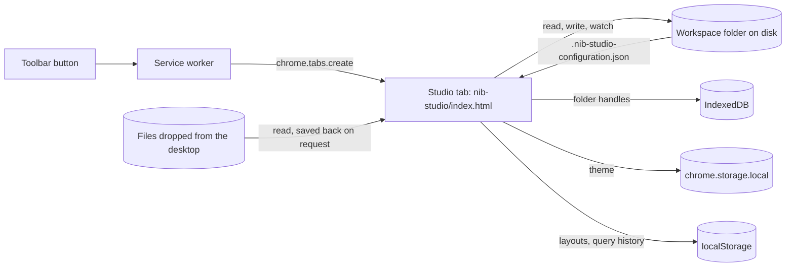
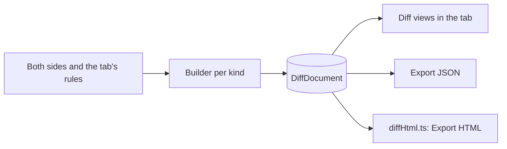

# Overview

A Manifest V3 extension for Chromium browsers 126+.  
The service worker only opens the studio; the studio tab does everything else, on files in a folder you pick.

- **Runtime:** Chromium 126+, Manifest V3, File System Access API
- **Source:** TypeScript (strict), no UI framework, SCSS, bundled by esbuild
- **Editor:** CodeMirror 6
- **Tests:** Vitest, co-located `*.test.ts` files and the build scripts' `*.test.mjs` files, pure logic on Node (`logic` project) and UI code on happy-dom (`studio` project)

## How it works



- The toolbar button runs the action.
  The service worker answers by opening `nib-studio/index.html` in a new tab.
  It holds no state and does nothing else.
- The studio tab is an ordinary extension page.
  It asks for a folder with `showDirectoryPicker`, keeps the folder handle in IndexedDB, and reads and writes files through that handle.
- Files dropped from the desktop come with their own handles where Chromium gives them.
  A dropped file outside the workspace opens in a tab that saves back through its handle; the handle lives only in the tab's memory.
- Nothing leaves the machine.
  The extension has no host permissions and every library is bundled into `dist`.

## Layout

```
┌──────────────────────────────────────────────────────────────────┐
│ Header: brand · workspace switcher · Files | Hash & encode · ☾    │
├──────────────┬───────────────────────────────────────────────────┤
│ Explorer     │ Tab bar                                           │
│ ⊟ ⊞          ├───────────────────────────────────────────────────┤
│ Look up…     │ Toolbar: view tabs · type badge · actions · Save  │
│ folder tree  │                                                   │
│              ├───────────────────────────────────────────────────┤
│              │ Editor or view                                    │
├──────────────┴───────────────────────────────────────────────────┤
│ Status bar: file · language · UTF-8 · unsaved · workspace · ⚙     │
└──────────────────────────────────────────────────────────────────┘
```

- **Header:** the workspace switcher, the two surfaces, **Files** and **Hash & encode**, and the theme toggle.
- **Explorer:** the folder tree of the active workspace, with **Look up files…** above it; see [Lookup](Lookup.md).
  A divider separates it from the editor; drag it to resize, drag it shut or double-click it to hide it,
  and click the `›` strip it leaves to show it again.
  At 720 px wide or less the Explorer becomes a drawer that the `›` strip opens over the editor.
  On **Hash & encode** the Explorer and its divider are hidden; the cards take the full width.
- **Main area:** on **Files**, the tab bar, the toolbar with the view tabs for the active file, and the editor or view.
  File tabs and diff tabs share the tab bar.
  On **Hash & encode**, the Hash, Verify, HMAC, Encode / Decode and JWT decode cards.
  Without a workspace, a start screen with **Choose folder**, **Re-open last workspace** and **Start a compare**.
- **Status bar:** the active file or diff tab, its language, the encoding, the unsaved count, the workspace and the About button.

The interface is in English only.

## Architecture

The code splits in two:

- `src/common` holds pure logic with no DOM rendering: file system access, the workspace registry and config, the directory watcher,
  text encodings, parsers, YAML reading and formatting, comparers, diff documents, path builders, Lookup's index and matching,
  hashing and HMAC, the Base64, URL, hex and HTML codecs, JWT decoding, exporters.
  It is tested on Node.
- `src/nib-studio` holds the UI: the app shell, the store, the command registry, the Explorer, the editor and every view.
  It is tested on happy-dom.

Inside the UI:

- **Store:** one `Store` in `app/store.ts` keeps the app state: workspace, remembered workspaces, tree, open files, diff tabs, tab order,
  active tab, active surface, expanded folders, selection and theme.
  `update` merges a patch and notifies the single subscriber, `App`, which re-renders the sidebar, the main area and the status bar,
  saves the theme, and schedules the workspace config write.
- **App:** `app/app.ts` is the composition root.
  It owns every file operation: open, save, create, rename, duplicate, delete, move, copy, import, compare.
- **Command registry:** `App.buildCommandRegistry` lists every context-menu command once, with `appearsIn` (`tree`, `tab` or `both`),
  a `group` number for the dividers, `enabledWhen` and `run`.
  `buildContextMenu` in `app/commands.ts` filters it for the surface and turns commands with `children`, such as **Compare with…**,
  into a header with sub-items.
  The Explorer and the tab bar show the same menu renderer.
- **Editor:** `editor/editorHost.ts` mounts CodeMirror with one session per open file, so the caret, the scroll and the undo history
  survive switching views and tabs, and docks the editor bar from `editor/editorBar.ts` above it.
  The editor holds text with `\n` line breaks; `common/text/lineEndings.ts` finds a file's line ending when it loads,
  and `textForDisk` in `app/store.ts` puts it back on save.
  `common/text/textEncoding.ts` finds a file's encoding, UTF-8 or a single-byte code page such as Windows-1253,
  for the editor, Lookup and the binary sniff alike, and `bytesForDisk` writes the file back in it.
- **Interactive view:** `editor/markdownLivePreview.ts` builds the view from the `live*` modules,
  which decorate CodeMirror's Markdown syntax tree while the text stays the file's Markdown:
  `liveItems.ts` describes a hidden or replaced range and which side of it the caret keeps,
  `liveBlocks.ts` draws code boxes, front matter, Mermaid diagrams, rules and table grids,
  `liveInline.ts` hides inline markers and heading marks, and draws bullets, numbers, checkboxes, links and images,
  `liveCaret.ts` keeps the caret out of hidden syntax, and `liveEditing.ts` handles typing, deleting, `Enter` and the table keys and menu.
  `markdownTables.ts` finds tables and their cells, `linkPopover.ts` edits a link's address on `Ctrl+K`,
  and `markdownPaste.ts` with `htmlToMarkdown.ts` turns pasted HTML into Markdown.
  HTML's Interactive view is `editor/htmlLivePreview.ts`: `htmlStructure.ts` reads elements from the HTML syntax tree,
  `htmlLiveItems.ts` hides tags and draws boxes, bullets and images, `htmlLiveEditing.ts` keeps tags through every edit
  and handles `Enter`, `Backspace`, `Delete` and the caret, and `htmlFormatting.ts` holds the HTML buttons of the editor bar.
- **Views:** `views/filesSurface.ts` picks the views for the active file.
  `viewOptionsFor` maps the file type to its view tabs; `viewerKinds.ts` picks the viewer for a file name,
  and `tableViewer.ts` renders tables.
  Word documents, PDFs, images, audio, video, fonts and archives mount once per tab through `previewPane.ts`
  into the shared frame of `previewFrame.ts`, and stay mounted while unrelated state changes.
  `archivePreview.ts` shows an archive's message and File details without reading the file.
  `documentView.ts` shows Word files read by `common/office/`, `pdfPreview.ts` shows PDFs through pdf.js and `common/pdf/`,
  and locked PDFs, Word files and workbooks share the password box of `passwordPanel.ts`,
  TIFF decodes in the `imageDecodeWorker.ts` worker, and `common/font/` reads font tables for `fontPreview.ts`.
  A Word or PDF preview takes a phrase to find from `previewFindRequests.ts`, as Lookup asks when it opens one at a match.
  `views/observeResize.ts` is the one way views watch an element's size: once a frame, and only for a new size.
  See [Preview](Preview.md) and [Documents](Documents.md).
- **Lookup:** `lookup/lookupBox.ts` is the box above the tree and its panel of results,
  `lookupClient.ts` talks to the `lookupWorker.ts` worker, and `lookupPdfText.ts` reads PDF text through pdf.js for it.
  The index itself is `common/lookup/`: `lookupIndex.ts` lists the workspace and reads each file once,
  `lookupExtractors.ts` reads each kind of file with the studio's own readers,
  `lookupQuery.ts` and `lookupMatcher.ts` match and rank, `lookupResults.ts` builds the previews,
  and `lookupService.ts` puts the index behind the worker's messages.
  See [Lookup](Lookup.md).
- **Keys and text boxes:** `app/shortcutKey.ts` reads a `Ctrl` shortcut's letter by the key's place when the key isn't a Latin letter,
  so `Ctrl+σ` on a Greek layout is `Ctrl+S`, for the tree keys of `app/keybindings.ts`, `Ctrl+S` in `app/saveShortcut.ts`,
  Lookup, the previews and the text boxes.
  `views/textBoxHistory.ts` gives the JSONPath, XPath and Schema boxes an undo history that outlives the box,
  so `Ctrl+Z` reaches back past a trip to another view.
- **Markdown and HTML previews:** `views/markdownPreview.ts` draws rendered Markdown for **Preview** and **Split**,
  and `views/htmlPreview.ts` draws an HTML file in a sandboxed frame without scripts, through `common/html/htmlPreviewDocument.ts`.
  `common/markdown/preview.ts` renders with markdown-it and sanitises the result, raw HTML included,
  in `sanitizeMarkdownHtml.ts` through `common/html/purifyHtml.ts`.
  `common/fs/workspaceReference.ts` resolves a link or image path against the document's folder,
  `entryLookup.ts` finds it case-insensitively when the exact name fails,
  and `workspaceResources.ts` reads images into blob URLs, released when a preview no longer shows them,
  and a style sheet from its tab when it has unsaved edits.
  `views/documentImages.ts` gives the previews and exports those resources with TIFF pictures turned into PNG
  in the decode worker, and a HEIC picture's placeholder text.
  `common/markdown/localImages.ts` fills images in a preview, the Interactive view and the exports,
  and caps an exported page's images at 25 MB,
  `common/html/styleSheets.ts` reads an HTML page's style sheets in,
  `views/fragmentScroll.ts` finds and scrolls to a `#fragment` in either preview,
  and `views/workspaceLinks.ts` hands link clicks to `openWorkspaceLinkAsync` in `app/app.ts`
  and opens web, `mailto:` and `tel:` links in a new browser tab.
  Each view renders into the editor pane and keeps its own small module state, such as the JSONPath expression.
  The JSON and XML trees share `views/pathBar.ts`, which shows the selected node's path and reveals a node by its path.
  YAML's views read it as JSON data through `common/yaml/yamlToJson.ts`:
  `views/yamlTreeView.ts` draws the JSON tree with a **Document** item per document,
  and the JSONPath, Schema and diff views take a `DataFormat` that says how to read the text.
  The JSONPath and XPath views share `views/pathResults.ts`, which draws the query bar and the result cards,
  and the Schema view uses its cards for errors; `common/paths/valueFormat.ts` formats the values.
- **Diff tabs:** `app/diffTabs.ts` opens, de-duplicates, swaps and persists diff tabs;
  `views/diffTabView.ts` routes a diff tab to the text, JSON, YAML, XML, Markdown or row diff view,
  YAML going to the JSON diff view with a format that reads YAML,
  and each tab owns a `DiffViewState` from `views/diffViewState.ts`, so it comes back as it was left.
  Each view keeps the tab's diff document in that state and draws only from it;
  `views/diffExport.ts` turns the same document into the tab's **Export JSON** and **Export HTML** downloads.
  `views/diffNavigationBar.ts` draws the bar at the bottom right of the text, JSON, YAML, XML and row diffs,
  and `views/diffPopover.ts` holds the toolbar popovers: **Compare rules** from `views/textRulesMenu.ts`
  and **Rules (n)** from `views/diffRulesMenu.ts`.
- **Drag and drop:** `explorer/dragDrop.ts` handles drags inside the tree and imports onto it;
  `app/desktopDrop.ts` shows the hints while files are over the window and opens what is dropped anywhere else;
  `app/droppedItems.ts` reads the dropped files and folders, through file system handles where the browser gives them.
- **Dialogs:** `app/dialog.ts` is the single dialog; confirmations, name inputs and the collision prompt are thin wrappers over it.

### Diffs in two steps

Every compare first builds a **diff document**, then draws it.  
`src/common/diff/` holds both steps, with no DOM:

- `diffDocument.ts` defines the `DiffDocument`: plain, deterministic JSON with the sides, the options, a summary,
  every change, and both sides aligned row for row, `null` standing for a placeholder.
- One builder per kind runs its engine and aligns the rows:
  `textDiffDocument.ts` over the line diff with compare rules, `jsonDiffDocument.ts` over the JSON comparer,
  for JSON and for YAML read as JSON,
  `xmlDiffDocument.ts` over the XML compare, `rowDiffDocument.ts` over the row compare,
  and `markdownDiffDocument.ts`, which wraps the Markdown compare as it is.
  The JSON and XML builders share the tree alignment in `treeDiffRows.ts`.
- `diffHtml.ts` turns any document into a standalone page, with inline styles and an ES5 script for its bar;
  a Markdown document goes to the Markdown diff's own renderer, so its page is the one the tab shows.



The views align nothing themselves:
they draw the document's rows, open and close tree nodes, and step the bar through its changes.

## Workspace model

- A workspace is a real folder on disk.
  There is no app-private file storage.
- Several workspaces are remembered, one is active.
  Their handles live in IndexedDB.
- Each workspace keeps its own session in `.nib-studio-configuration.json` at its root.
- Paths are relative to the workspace root, with forward slashes, such as `data/orders.json`.

See [Workspaces](Workspaces.md).

## Repository layout

```
nib-studio-chrome-extension/
├─ src/
│  ├─ background/main.ts      # service worker: opens the studio tab
│  ├─ common/                 # pure logic
│  │  ├─ fs/                  # file I/O, tree, watcher, workspace registry and config, file types, in-memory fake for tests,
│  │  │                       # workspace paths of links and images, case-insensitive lookup, blob URLs for previews
│  │  ├─ json/                # parser, JSONPath, schema validation, generator and sample builder, comparer
│  │  ├─ xml/                 # XML to JSON, XML compare
│  │  ├─ yaml/                # YAML parse and validation, format, YAML to JSON and JSON to YAML, on the yaml package
│  │  ├─ paths/               # XML parser, XPath evaluator and builder, JSONPath builder, value formatter, query examples
│  │  ├─ markdown/            # preview renderer, its sanitiser, workspace images, and the Markdown diff
│  │  ├─ html/                # DOMPurify passes, the HTML preview page, style sheets read in, link tooltips, escaping
│  │  ├─ csv/                 # CSV parser, large-file index and scans, row compare
│  │  ├─ linq/                # the table query language: tokeniser, parser, evaluator, reference
│  │  ├─ text/                # line diff with compare rules, line endings, encodings, byte sizes, times, text sniffing,
│  │  │                       # and the case and accent folding Word and PDF Find and Lookup share
│  │  ├─ lookup/              # Lookup's index: listing, readers per file type, matching, ranking, previews
│  │  ├─ binary/              # little- and big-endian integer readers, byte comparison and joining
│  │  ├─ diff/                # diff documents: one builder per kind, and the standalone HTML page
│  │  ├─ office/              # Word readers (DOCX, .doc, property sets) and XLSX loader;
│  │  │                       # encryption/: Office password decryption (Agile, Standard, RC4, CryptoAPI, XOR)
│  │  ├─ crypto/              # RC4, and AES-CBC and AES-ECB on Web Crypto without padding
│  │  ├─ pdf/                 # PDF details, dates, page sizes, page layout and links
│  │  ├─ image/               # image formats, frame counts, EXIF, HEIF image sizes, TIFF decoding, test builders
│  │  ├─ font/                # font containers and the name, cmap, OS/2, head, maxp and fvar tables
│  │  ├─ preview/             # Info panel rows and their formats, media type names
│  │  ├─ hash/  encoding/     # MD5, SHA digests on the calling thread, Web Crypto digests and HMAC,
│  │  │                       # checksum matching, codecs, JWT
│  │  ├─ export/              # HTML and PDF export
│  │  └─ session/             # theme in chrome.storage.local
│  └─ nib-studio/             # the studio tab
│     ├─ main.ts  index.html  styles.scss
│     ├─ imageDecodeWorker.ts # the TIFF decode worker
│     ├─ lookupWorker.ts      # the Lookup worker, which reads and searches the workspace
│     ├─ app/                 # App, store, shell, commands, dialogs, status bar, toasts, About, desktop drops, shortcut keys
│     ├─ explorer/            # tree view, selection, keyboard, drag and drop, context menu
│     ├─ lookup/              # Lookup's box and panel, its worker client, PDF text for it
│     ├─ editor/              # CodeMirror host, editor bar, Markdown formatting, list keys and paste, tab bar,
│     │                       # the Interactive view: markdownLivePreview, live*, markdownTables, linkPopover,
│     │                       # and HTML's: htmlLivePreview, htmlLiveItems, htmlLiveEditing, htmlFormatting
│     ├─ views/               # Files surface, every view, diff views with their bar and popovers, Hash & encode,
│     │                       # the text boxes' undo history
│     ├─ testing/             # test helpers: app harness, DataTransfer fake, fixtures
│     ├─ theme/               # copy of the shared palette
│     └─ vendorLicenses.ts    # generated, shown in About
├─ public/                    # manifest.json and icons
├─ scripts/                   # build, icons, licences
├─ vendor/                    # SheetJS tarball, licence texts; dependency tarballs on demand
├─ docs/
├─ Invoke-Test.ps1            # type check and tests
├─ Start-Debug.ps1            # watch build and a browser profile that loads it
├─ Publish-Extension.ps1      # test, bump the version, build, zip for manual upload
├─ Package-Vendor.ps1         # pack every dependency for an offline rebuild
└─ Compress-Source.ps1        # zip the source, leaving out what git ignores
```

## Permissions

| Permission | Why |
| --- | --- |
| `storage` | Keep the theme choice in `chrome.storage.local`. |

No host permissions, no `tabs`, no content scripts.  
Opening a tab on the extension's own page needs no permission.  
Folder access comes from the File System Access API, granted per folder by you in the browser's own prompt, not from the manifest.

## Offline

- esbuild bundles every import into `dist`; nothing loads from a CDN.
  The image decode worker is bundled to `nib-studio/imageDecodeWorker.js`, and the Lookup worker to `nib-studio/lookupWorker.js`.
  HEIC pictures are never decoded, so the extension ships no HEVC decoder.
  pdf.js's legacy build is bundled into `main.js`, and its worker, CMaps, the Symbol and Dingbats fonts,
  and its JavaScript JBIG2 and JPEG 2000 decoders are copied to `nib-studio/pdfjs/` with their licences.
- The content security policy allows scripts and connections only from the extension itself,
  fonts from the extension and `data:`, and images and media from the extension, `data:` and `blob:`.
- Dependencies are pinned in `package.json`.
- SheetJS comes from a tarball committed under `vendor/sheetjs/`, because the npm `xlsx` package has an advisory.
- `Publish-Extension.ps1 -IncludeVendor` also writes a sources zip with every dependency tarball, for a rebuild without registry access.
  See [Release](Release.md).
